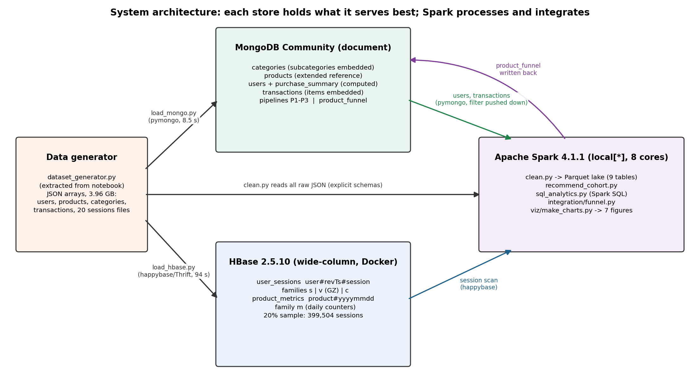

# Distributed Multi-Model Analytics for E-commerce Data

AUCA MSc Big Data Analytics, final project (individual): **Mugabo** · Student ID: _101226_

MongoDB (document store), HBase (wide-column store) and Apache Spark (processing and integration) applied to a
synthetic e-commerce dataset: 10,000 users, 5,000 products, 2,000,000 sessions and 500,000 transactions over 90 days.



## Repository layout

```
dataset_generator.py      supplied generator (Jupyter notebook JSON despite the .py name; kept unchanged)
generator.py              code cell extracted from the notebook (identical logic)
mongo/                    load_mongo.py, pipelines.py (P1 revenue by category/month, P2 segments + $merge, P3 top products)
hbase/                    Dockerfile + hbase-site.xml (arm64 HBase 2.5.10), create_tables.hbase,
                          load_hbase.py (20% sample), queries_hbase.py, queries.hbase (shell examples)
spark/                    common.py, clean.py (raw JSON -> Parquet lake), recommend_cohort.py, sql_analytics.py
integration/              funnel.py (HBase sessions + MongoDB transactions joined in Spark; writes product_funnel)
viz/                      make_charts.py (7 figures), architecture.png
results/                  outputs, timings, figures (generated)
```
Not in the repository (local only): `data/` (raw JSON, ~4 GB), `lake/` (Parquet), `hbase_data/`, `.venv/`.

## Requirements

macOS/Linux, Python 3.12+ (tested with 3.14), Java 17 or 21 for Spark, Docker Desktop (≥ 4 GB for HBase),
MongoDB Community, about 10 GB free RAM for data generation and 10 GB of disk.

```bash
python3 -m venv .venv && source .venv/bin/activate
pip install faker numpy "pandas<3" pyspark pyarrow pymongo happybase matplotlib
echo 'unset SPARK_HOME' >> .venv/bin/activate      # use PySpark's bundled Spark, not another install
brew tap mongodb/brew && brew install mongodb-community && brew services start mongodb-community
```

## Run everything (in this order, from the project root)

```bash
# 0. Generate the data (about 6 minutes, peak about 10 GB RAM; dates/IDs differ on every run)
shasum -a 256 dataset_generator.py          # 0a88e46f2b0f02ffa5c28a29e477d1ea7c3c1e4ea6c10eaf3bfd94c6514df505
python -c "import json; nb=json.load(open('dataset_generator.py')); open('generator.py','w').write(''.join(nb['cells'][0]['source']))"
mkdir -p data results/{mongo,hbase,spark,integration,figures} && cd data && python ../generator.py && cd ..

# 1. MongoDB (Part 1)
python mongo/load_mongo.py | tee results/mongo/load.txt
python mongo/pipelines.py  | tee results/mongo/pipelines.txt

# 2. HBase (Part 1)
docker build -t hbase-local hbase/
docker run -d --name hbase -p 16010:16010 -p 9090:9090 -p 8080:8080 -p 2181:2181 -v "$PWD/hbase_data:/data" hbase-local
sleep 40
docker exec -i hbase hbase shell -n < hbase/create_tables.hbase
python hbase/load_hbase.py    | tee results/hbase/load.txt
python hbase/queries_hbase.py | tee results/hbase/queries.txt
# HBase master UI: http://localhost:16010   shell: docker exec -it hbase hbase shell

# 3. Spark (Part 2). On a 16 GB machine stop HBase during the two heavy jobs
docker stop hbase
python spark/clean.py            2>&1 | grep -v WARN | tee results/spark/clean.txt
python spark/recommend_cohort.py 2>&1 | grep -v WARN | tee results/spark/recommend_cohort.txt
docker start hbase && sleep 45
python spark/sql_analytics.py    2>&1 | grep -v WARN | tee results/spark/sql.txt

# 4. Integrated funnel (Part 3) and charts (Part 4)
python integration/funnel.py 2>&1 | grep -v WARN | tee results/integration/funnel.txt
python viz/make_charts.py
```

## Sample queries

**MongoDB** (mongosh, database `ecommerce`):
```js
db.users.findOne({_id: "user_000042"}, {purchase_summary: 1})                 // computed pattern
db.transactions.find({user_id: "user_000042"}).sort({timestamp: -1}).limit(5)  // uses {user_id, timestamp} index
db.transactions.aggregate([{$unwind: "$items"}, {$group: {_id: "$items.category_id", units: {$sum: "$items.quantity"}}}, {$sort: {units: -1}}])
db.product_funnel.find().sort({view_to_purchase_pct: -1}).limit(5)             // written back by Spark
```
**HBase** (shell):
```
scan 'user_sessions', {ROWPREFIXFILTER => 'user_000042#', COLUMNS => ['s'], LIMIT => 5}
scan 'product_metrics', {STARTROW => 'prod_00001#20260901', STOPROW => 'prod_00001#20261001'}
```
**Spark SQL**: see `spark/sql_analytics.py` (window functions, MongoDB × HBase join).

## Key results (my run, data generated 6 Nov 2026)

| | |
|---|---|
| MongoDB load / pipelines | 515,025 docs in 8.5 s; P1 1.12 s, P2 0.51 s, P3 0.55 s |
| HBase | 399,504 sessions (20%), 10.4M cells in 94 s; key scans ~10 ms vs full scan 3.6 s |
| Spark clean | 2M sessions → 20M page views, 0 money/duration errors, ~126 s |
| Funnel | 20.4% flagged converted vs **12.9% real purchases**; 0 cross-system mismatches |
| Stock-outs | 2,492 products (49.8%) sold out and lost views and sales (Fig. 3 in report) |

## Notes / known issues

- Spark 4 uses ANSI SQL: division by zero is an error, so the code uses `try_divide`.
- Python workers must match the driver's Python version; `spark/common.py` sets `PYSPARK_PYTHON`.
- The Java `FileNotFoundException` printed for `data/sessions_*.json` during `clean.py` is a harmless log line.
